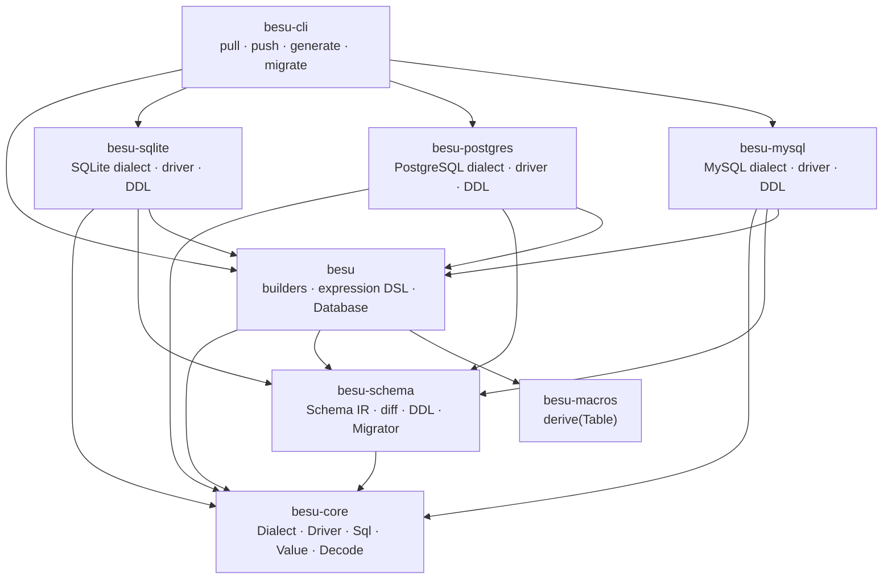
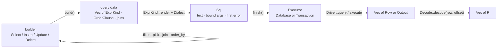

Besu is built as four independent layers rather than one crate with feature flags. The split
is not decoration: each seam exists because something useful becomes possible when a
particular dependency is absent.

## The crate graph



Every arrow points from a crate to something it depends on. There are no cycles.

- `besu-core` depends on nothing in the workspace. It has no query API, no database driver
  and no proc macro. It can build and render SQL on its own.
- `besu` depends on `besu-core` for the vocabulary, on `besu-schema` for migrations, and on
  `besu-macros` for the derive. It does not depend on any database.
- Each driver depends on `besu-core`, `besu-schema` and `besu`. The dependency on `besu` is
  only for `SchemaDriver`; the execution path goes straight to `besu-core`.
- `besu-cli` is the only place that knows about all three backends at once, because a CLI has
  to dispatch on a URL at runtime.

If you want to add a dependency from `besu-core` to anything else in the workspace, the
abstraction is wrong. Say so in an issue rather than adding the edge.

## Why the seams are where they are

### Dialect versus driver

A `Dialect` is a compile-time tag that knows how to spell SQL: placeholders, quoting, type
names, capability flags. It can render a complete statement with no connection. A `Driver`
only moves bytes to a server and rows back. Everything about *what* SQL to run lives in the
dialect; everything about *how to reach the database* lives in the driver.

That split is what makes the following possible:

```rust
let db = besu::dry::<besu_sqlite::SQLite>();
let sql = db.select(users).filter(users.age.gt(18)).to_sql()?;
```

No pool, no connection string, no server — and the SQL is the real SQL, not an approximation
produced by a second implementation.

### `Executor` versus `Driver`

A builder is generic over an `Executor`, not over a driver. `&Database<Dr>` and
`&mut Transaction<'_, Dr>` both implement `Executor`. That is why the same `Select` value can
run on a pool, inside a transaction, or against `DryDriver` without a second query API:

```rust
impl<Dr: Driver> Executor for &Database<Dr> { /* ... */ }
impl<'a, Dr: TransactionDriver> Executor for &mut Transaction<'a, Dr> { /* ... */ }
```

The dialect is not a separate type parameter on `Executor`; it is a projection of the
driver (`DialectOf<E>`), so an executor's dialect and driver can never disagree.

### Schema as a separate crate

The schema IR is shared by three producers (the derive, introspection, a JSON snapshot) and
two consumers (`diff`, `Ddl`). Keeping it out of `besu` means the CLI can diff a snapshot
against a live database without linking the query builders, and `besu` can expose `push`
without depending on the CLI.

### Macros generate metadata, not queries

`#[derive(Table)]` emits a plain struct, a `const` handle, an insert struct and a
`&'static TableDef`. It does not generate per-query code and it does not run at query time.
The hot path contains no proc-macro output beyond ordinary structs and impls.

## How a query becomes SQL

Every builder is a plain data structure with a type parameter or two for checking. `Select`,
for example, holds a `SelectQuery`:

```rust
pub(crate) struct SelectQuery {
    pub(crate) from: &'static TableDef,
    pub(crate) projection: Option<Vec<ExprKind>>,
    pub(crate) joins: Vec<JoinClause>,
    pub(crate) filter: Vec<ExprKind>,
    pub(crate) group_by: Vec<ExprKind>,
    pub(crate) having: Vec<ExprKind>,
    pub(crate) order_by: Vec<OrderClause>,
    pub(crate) limit: Option<i64>,
    pub(crate) offset: Option<i64>,
    pub(crate) distinct: bool,
    pub(crate) lock: Option<Lock>,
}
```

Each builder method pushes into one of those vectors and returns `Self`. Nothing is rendered
until the end.



Step by step, for a select:

1. **Builder.** `db.select(users)` creates `Select` with `from = T::DEF` and an empty
   `SelectQuery`. `.filter(users.age.gt(18))` converts the condition to an `ExprKind` and
   pushes it. The type parameters `M` and `R` track the row set and the result type; they are
   erased at runtime.
2. **AST.** The filter is an `ExprKind::Binary { op: ">", left: Column { table: "users",
   column: "age" }, right: Value(Int(18)) }`. `ExprKind` is a closed, dialect-independent
   tree. There is no typed `Expr` left at this point: the types did their job at the call
   site and are gone.
3. **Render.** `SelectQuery::build::<D>()` walks the fields in SQL order and writes into a
   `Sql<D>`. `push_raw` appends text, `push_ident` quotes an identifier through the dialect,
   `bind` writes a placeholder and appends the value. `ExprKind::render` parenthesises every
   binary node, which is why the output is `("users"."age" > $1)` rather than relying on
   precedence.
4. **Finish.** `Sql::finish()` returns the statement if no error was recorded, or the first
   error if one was. Capability failures — `RETURNING` on MySQL, `FULL OUTER JOIN` on MySQL,
   `FOR UPDATE` on SQLite — are recorded here, before the driver sees anything.
5. **Execute.** `Executor::query` hands the rendered `Sql` to `Driver::query`, which converts
   each already-bound value into the driver's argument type and runs it. `execute` is the same
   path for statements that return no rows.
6. **Decode.** For a query, `Decode::decode` walks the row with a `usize` offset. A model
   consumes one column per field in declaration order; a tuple consumes one per element;
   `Option<T>` peeks for `NULL` before deciding.

The same pipeline serves a `RawQuery`: `sql!` produces a `Fragment`, `Fragment::render`
rewrites `?` placeholders and produces the same `Sql<D>`, and the same executor runs it.

## The error model

`Sql<D>` carries `Option<Error>` and keeps only the **first** error recorded. Later failures
are almost always a consequence of the first, and a single clear message beats a cascade. A
builder therefore does not return `Result` from every method; it records and keeps going, and
`finish()` is the single place that decides whether the statement is usable.

This is why `to_sql()` returns a `Sql` whose `.error()` may be set even though the call itself
returned `Ok`: inspection wants the partial text, execution wants the error. `Database`
execution always calls `finish()`.

## The allocation story

The design goal is: one SQL string per query, one encode per parameter, one allocation per
row of *result*, and nothing per row of *work*.

| Stage | What it costs |
| --- | --- |
| Table handle | None. A `const` struct of `Column`s, each a `&'static str`; `Copy` |
| Column reference | None. Copying a `Column` copies a pointer and a length |
| Expression node | One node in the enclosing vector. The operands of a comparison — a column and a literal — are stored inline, so `users.age.gt(18)` allocates nothing at all |
| Building | Clause vectors grow as clauses are added. A bulk insert reserves its whole row buffer from the iterator's size hint, so it allocates once |
| Rendering | One `Sql`: the text is pre-sized from a per-query estimate and the argument vector is sized exactly for an insert |
| Identifier quoting | `Dialect::write_ident` writes into the statement buffer. No `String` per identifier |
| Placeholders | Written into the same buffer; PostgreSQL's `$N` is built from digits, not `to_string` |
| Parameter binding | The value is *moved* into `Sql::args`. Nothing is cloned on an execution path |
| `to_sql` | One clone of the query, because `to_sql` takes `&self` and leaves the builder usable |
| Execution | `query` collects `Vec<Row>`; `stream` yields one row at a time instead |
| Decoding | One `Vec<R>` sized to the row count, and one `try_get` per column |
| Awaiting | One boxed future per `IntoFuture`, which is how an `async` body gets a nameable type |
| Driverless build | No database, no connection, no I/O |

`cargo bench -p besu` measures the builder. It uses a dry database and a hand-written
dialect, so no server is needed and the numbers are exactly the cost Besu adds on top of a
driver. On a Ryzen-class machine, release build:

| Query | Time |
| --- | --- |
| `select` with one filter | 157 ns |
| `select` with three filters, `ORDER BY` and `LIMIT` | 318 ns |
| `select` with a projection and `COUNT(*)` | 152 ns |
| `insert` one row | 193 ns |
| `insert` one hundred rows | 10.5 µs |
| `update ... set ... where` | 246 ns |

Those numbers include `to_sql`, and therefore include the query clone described above. A
query that runs moves its values instead and pays less. The bulk insert is dominated by
cloning a hundred pre-built rows for the same reason; executing one moves them.

Three honest caveats:

- The table handle is not literally zero-sized: each `Column` stores its name as a
  `&'static str`, which is 16 bytes on a 64-bit target. A five-column handle is 80 bytes,
  all `Copy`. It is small and free to pass around, not a ZST.
- Storing operands inline makes an `ExprKind` node larger (about 104 bytes rather than 32)
  so that a `WHERE` clause costs no allocations. A query holds tens of nodes, not millions,
  so the trade is a few hundred bytes of vector space against two allocations per condition.
- The capacity estimate is an estimate. It errs high, so a statement can carry a few hundred
  spare bytes of `String` capacity; it is sized to avoid copies, not to be exact.

What is deliberately absent is just as important: there is no query cache, no lazy loading, no
identity map, no N+1 machinery and no hidden second statement. A query is a value, and running
it does exactly what its SQL says.

## Threading and lifetimes

Builders borrow the executor for `'a`: `Select<'a, &Database<Dr>, M, R>`. A query cannot
outlive the database it will run on, and a transaction cannot outlive the borrow of the
database. `IntoFuture` boxes a future with a `Send` bound when the executor is `Send`, which
is what lets queries run on a multi-threaded runtime. `Driver` is `Send + Sync + 'static`, so
a pool can be cloned into as many tasks as you like.

## Compiling for wasm32

The query builder compiles and runs on `wasm32-unknown-unknown`. A web front end can build
the same typed query the server would build and render the exact SQL it will send. Nothing
in that path needs a socket, a filesystem, an async runtime or a clock: it is `alloc` and
arithmetic. The intended use is generating SQL on the client for a server to execute.

```toml
[dependencies]
# The builder, the derive and the SQL: all of it is at home in a browser.
besu = { version = "0.1", default-features = false, features = ["derive"] }
# The dialect and DDL only. The default features are `sqlx` and `runtime-tokio`.
besu-postgres = { version = "0.1", default-features = false }
```

```rust
// On the client.
let db = besu::dry::<besu_postgres::Postgres>();
let sql = db
    .select(users)
    .filter(users.age.gt(18))
    .limit(50)
    .to_sql()?;

// POST `sql.sql()` and `sql.args()` to the server, which runs the same builder with a
// real database behind it and lets the driver do the actual work.
```

| Crate | On `wasm32-unknown-unknown` |
| --- | --- |
| `besu-core` | Works. It is `no_std`-shaped apart from the `std::error::Error` impl on `Error`, and `std` does exist on this target. `chrono`, `uuid` and `serde_json` are values, not services. |
| `besu` | Works with every feature, including `derive`, `migrate` and `tracing`. Building, rendering, `sql!` and the schema IR never reach for the operating system. |
| `besu-sqlite` / `-postgres` / `-mysql` with `default-features = false` | Works: the dialect and the DDL, which is what a client needs to spell `?`, `$1` and identifiers correctly. |
| Any driver feature (`sqlx`, `runtime-tokio`) | Does not build. sqlx reaches tokio, tokio reaches mio, and mio needs a socket API that this target does not have. |
| Running a query, `push`, `introspect`, `Migrator` | Do not run. Every one of them needs a `SchemaDriver` or a `Driver`, which means a connection. `Database` itself is fine to hold; it just has nothing to talk to. |

The boundary is enforced, not assumed: the `wasm` CI job checks `besu-core` and `besu` for
this target and `besu/tests/dry.rs` asserts the rendered SQL on every platform. There is no
`wasm` feature flag, because nothing in the builder needed one; a feature nobody has to
enable cannot silently rot.

### What still traps

`std` compiles for this target, but parts of it do not work, and the failure is a trap at
run time rather than an error at build time:

- `std::time::Instant::now()` panics. The `tracing` feature compiles, but `besu::logged(..)`
  reads the clock once a subscriber has the `besu::query` target enabled, so the wrapper
  traps in a browser exactly when logging is switched on. With no subscriber it never touches
  the clock.
- `chrono::Utc::now()` panics as well, unless `chrono/wasmbind` is enabled (which pulls in
  `wasm-bindgen` and its loader). Besu never reads the clock: `now()` in an expression writes
  the SQL `CURRENT_TIMESTAMP` and the database evaluates it, and a timestamp that came from
  JavaScript is just a `Value::TimestampTz`.
- `Send + Sync` bounds still compile. A wasm module is single-threaded, so the bounds are
  vacuous on this target, not wrong.

Decoding is the other half of the boundary: `Decode` is implemented *by each driver*, because
pulling a value out of a row is database-specific. A browser has no rows and no `Decode`, which
is exactly why `dry::<D>()` is the honest executor there: it renders, and attempting to run the
statement returns an error.

## What each layer is allowed to know

| Layer | Knows about | Must not know about |
| --- | --- | --- |
| `besu-core` | SQL text, values, dialects, drivers, decoding | Query builders, schema diffing, any database crate |
| `besu` | Builders, expressions, `Database`, transactions | sqlx, a specific database, DDL |
| `besu-schema` | The IR, diffing, DDL, migrations | Query builders, drivers |
| `besu-sqlite` / `-postgres` / `-mysql` | One database's SQL and wire protocol | The other databases |
| `besu-cli` | URL schemes, snapshots, files | Application query code |
| `besu-studio` | The schema IR, `AnyDatabase`, HTTP | Typed query builders, application models |

## The studio

`besu studio` is the only interactive consumer of the layers above, and it is a subcommand of
the CLI: the server is a library (`besu-studio`) that the binary serves, so the web stack stays
out of `besu` and `besu-core` while shipping as one command. The CLI depends on `besu-studio`;
nothing in the library depends on the CLI.

It uses only the dynamic APIs. `AnyDatabase::introspect` supplies `GET /api/schema`; the row
endpoint matches on the backend, asks the driver for each cell as text — the driver is the
only layer that knows how a row is laid out — projects `NULL` through `Driver::is_null`, and
uses the introspected column type to restore numbers, booleans and JSON. The page is one
HTML file inlined into the binary, with no build step and no CDN.

### Security posture

There is no authentication, and the query endpoint runs any single statement, including one
that writes. That is deliberate for a development tool and unacceptable anywhere else, so:

- the binary binds `127.0.0.1` unless `--allow-remote` is passed, and prints what that means
  when it is;
- a table name in the row URL is checked against the introspected schema rather than
  interpolated into SQL, and the statement is built through `Sql`, which quotes identifiers
  the dialect's own way;
- the query endpoint refuses anything the migration splitter does not report as exactly one
  statement, so a pasted script is refused rather than half-run.

The statement is a `Fragment`, the same type `sql!` produces, so a bare `?` is a parameter
placeholder and `??` is a literal question mark. There are no parameters to bind from the
page, which is another reason the SQL box is for development only.

A studio fit for anything but a development machine would need authentication, an explicit
read-only mode and a write policy that is off by default. None of those are here.

## Gotchas

- **A dialect can be total and still be wrong.** `SUPPORTS_*` is a promise the dialect makes;
  if it claims `RETURNING` on a database that lacks it, the failure moves to the server.
- **`to_sql()` is not a dry run of execution.** It renders; it does not check the connection,
  the schema or the parameter count against a server.
- **The type parameters on a builder are not erased for the compiler.** `M` and `R` are
  phantom, but they still participate in inference; a long join chain produces deeply nested
  tuple types, and very long chains can hit trait-resolution limits.
- **`Sql` is generic over the dialect, never the driver.** That is deliberate: it is the type
  that lets a test suite assert on SQL with no database present.
